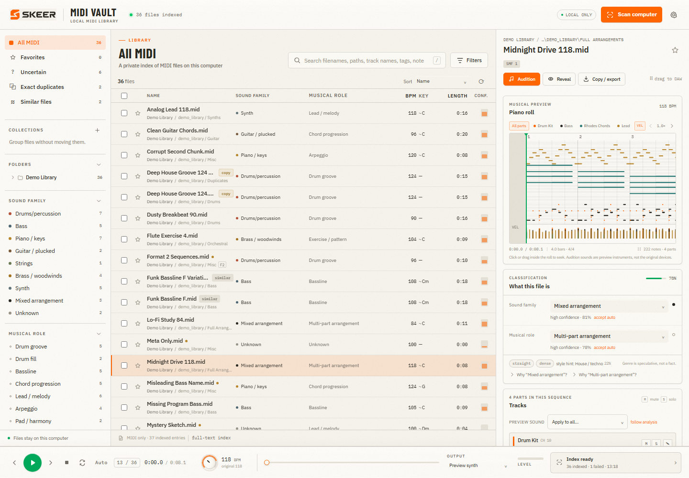
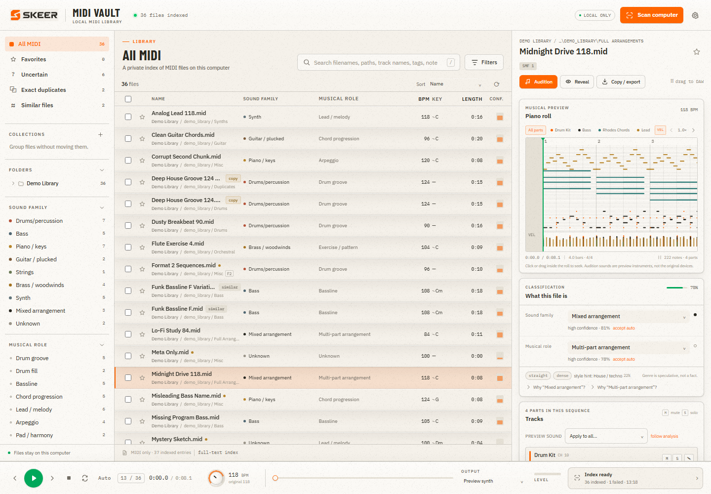

# SKEER MIDI VAULT

**A private, local-first MIDI library and audition tool from SKEER AUDIO.**

SKEER MIDI VAULT scans local folders, builds a persistent searchable index, reads
Standard MIDI Files, describes what is inside them, and lets you audition any
sequence without opening a DAW. Files stay where they are and are never modified.

- Local-only loopback service — no account, upload, analytics or cloud dependency
- Custom Standard MIDI File parser (formats 0, 1 and independent format-2 sequences)
- Searchable library with musical metadata, automatic classification and confidence
- Generated preview timbres plus optional Web MIDI output
- Two approved SKEER treatments: **Studio Clean** and **Studio Tactile**



*Studio Clean. The screenshot uses the generated demo library documented below.*



*Studio Tactile, the same components with the softer, grained finish.*

## Install (Windows 10/11, recommended)

The standalone builds all land in one folder, **`launch/`**:

- **[`SKEER MIDI VAULT/`](launch/SKEER%20MIDI%20VAULT/)** — the standalone
  application. Double-click `SKEER MIDI VAULT.exe` inside it; keep `_internal/`
  beside the exe, it holds the Python runtime and the interface bundle.
- **[SKEER-MIDI-VAULT-Setup-1.0.0.exe](launch/SKEER-MIDI-VAULT-Setup-1.0.0.exe)** —
  per-user installer, the file to send to customers. No Python, Node.js, terminal
  or admin rights required.
- **[SKEER-MIDI-VAULT-Portable-1.0.0.zip](launch/SKEER-MIDI-VAULT-Portable-1.0.0.zip)** —
  extract and run.
- **[SHA256SUMS.txt](launch/SHA256SUMS.txt)** — SHA-256 checksums for
  release distribution.

`launch/` is gitignored and refreshed by `packaging/build_installer.ps1`, which
writes every one of these deliverables there.

Run the Setup file, follow the short wizard, and launch from the Start Menu
shortcut. The application starts a loopback-only service, opens the interface in
your default browser, and stays available from a tray icon. Closing the tab does
not stop the local service; use the tray icon or
**Settings → Data & privacy → Quit SKEER MIDI VAULT** to exit.

The application requires Microsoft Edge or Google Chrome (standard on
Windows 10/11). The Setup file is currently **unsigned**; Windows SmartScreen may
warn until the seller signs it. Code-signing guidance and rebuild instructions
are in **[packaging/README.md](packaging/README.md)**.

The installed app stores its library at:

```text
%LOCALAPPDATA%\Skeer\MIDI Vault\midivault.sqlite3
```

Source MIDI files are opened read-only; the uninstaller leaves this local library
data in place.

## Run from source

Requirements:

- **Python 3.12 or newer** (standard library only; no `pip install` for the app)
- **Chrome or Edge** recommended for Web Audio/Web MIDI and drag support
- **Node.js 20 or newer with npm** only when rebuilding the interface. The
  delivered `web/dist` bundle is already built; on a fresh checkout or after
  editing interface sources, the launcher installs/bundles automatically.

1. Double-click **`start.bat`** (or run `powershell -ExecutionPolicy Bypass -File start.ps1`).
2. The script builds the interface when needed, starts the local service at
   `http://127.0.0.1:8737/`, and opens your browser.
3. Click **Scan computer**, choose drives/folders, and start the scan.
4. Use **Settings** for appearance and default scan behavior, and
   **Copy / export** or **Reveal** to work with the original file.

To use a different port or data folder, pass the existing server options through
the source launcher, for example:

```powershell
.\start.ps1 --port 8740
.\start.ps1 --data-dir "D:\Skeer Data\MIDI Vault"
```

The default local index location is deliberately on the user application-data
drive: SQLite WAL writes are frequent during a scan, and this project folder may
live on a slower archive drive. The service binds to loopback only.

### Run without the launcher

```powershell
# from the repository root
python -m midivault.server --open
```

The interface bundle in `web/dist` is served by the Python process. If the bundle
is missing, run `npm --prefix web ci` once and `npm --prefix web run build`.

## What it does

### Local index and scanning

- Discovers mounted local drives and mapped network locations; allows individual
  drives or arbitrary folders.
- Incremental scans skip unchanged files using size, mtime, parser version and
  classifier version.
- Explicit **Pause**, **Resume** and **Cancel**, with in-flight work finishing
  safely and completed rows staying committed.
- Background process workers keep parsing out of the interface. Memory and
  concurrency are bounded; the Balanced intensity uses two workers.
- Skips protected system locations, symlinks, junctions, cloud placeholders,
  excluded paths and archives. Source files are opened read-only and never
  renamed, moved or deleted.
- Unavailable drives stay remembered with their existing index entries. Missing
  files are marked, not silently removed.
- The SQLite database stores scan history, file errors, file/track analysis,
  user corrections, cached piano-roll notes and duplicate groups.

### Library browsing

- Left column: All MIDI, Favorites, Uncertain, exact/similar duplicates,
  collections, folder tree, sound-family and musical-role facets.
- Center: sortable, paged library table, multi-select and bulk
  favorite/tag/collection/classification actions.
- Right: file details, sources and embedded metadata, classification confidence
  and evidence, tags, notes, collections, tracks and a canvas piano roll.
- Full-text search (SQLite FTS5) over filenames, paths, track names, tags,
  embedded MIDI text and your notes, plus filters for instrument, role, BPM,
  meter, key, evidence source, duration, bars, pitch range, note density,
  feel tags, confidence, duplicate status, favorites, issues and source.

### Music reading and classification

- Custom SMF reader: formats 0/1/2, running status, variable-length quantities,
  metrical and SMPTE divisions, tempo maps, time-signature and key-signature
  events, sustain CC64, overlapping notes, multiple track chunks and malformed
  file recovery with warnings.
- Per-file and per-track automatic classification into transparent sound-family
  and musical-role taxonomies, with a confidence score, evidence list, conflicts
  and an Uncertain state.
- Embedded metadata and calculated estimates are labelled separately. Filename
  evidence is marked as such; a misleading filename does not become a fact.
- User corrections live in separate correction tables and are never overwritten
  by a rescan, classifier upgrade or index rebuild. The effective label can be
  reverted to the latest automatic prediction at any time.
- Optional straight/swung/sparse/dense/syncopated observations and a clearly
  labelled, low-confidence style hint are never treated as hard categories.
- Exact duplicates use SHA-256 file content; similar-music groups use a conservative
  musical fingerprint. Duplicates are shown, never auto-deleted. Similarity only
  ever compares fingerprints of the same generation, so an index built before a
  fingerprint change under-reports until it is re-scanned instead of guessing.

### Preview and audition

- Web Audio preview synthesizer for melodic tracks and drums; the piano roll and
  playhead are driven by the same parsed note data.
- Lookahead scheduler independent of React rendering; stop/switch/file-change
  releases all active notes.
- Transport play/pause, stop-to-zero, seek, loop, audition tempo, per-track
  mute/solo, optional Web MIDI output device, and sequence switching for
  independent format-2 files.
- An `Auto` toggle on the transport turns click-to-preview on: with it enabled,
  selecting a different file starts its preview immediately, and a preview that
  ends by itself opens the next row — your selection if the file is part of one,
  otherwise the list on screen. The run is bounded: it stops at the end of the
  list and says so, and pausing, stopping or seeking ends it without skipping the
  file you interrupted. Previous/next buttons step the same list by hand, and the
  transport shows how far through it you are. The setting is stored in the library
  database, defaults to off and survives restarts.
- Preview sounds are approximations, not the original instruments. The interface
  says so directly.
- Each track plays the voice its classification implies (drum kit, grand piano,
  electric piano, bass, plucked string, strings, brass, synth lead, synth pad, or
  a neutral default). Who is believed depends on who said it: your pick for that
  track first, then a category you corrected by hand, then the machine's guess for
  the track, then a file category you corrected, then the machine's file guess.
  Correcting a category — at file or track level — changes the voice without
  moving the playhead, resetting the loop or touching the audition tempo.
- A **Sound** picker per track, plus *Apply to all* and *follow analysis* in the
  Tracks card, overrides the classification whenever you prefer a different voice.
  Picks are stored in the browser (per file path, this machine only), never in the
  index, and are also sent as the General MIDI program when a hardware output is
  selected. `Auto` hands the decision back to the classification.

### Data and maintenance

- Online SQLite backup download in **Settings → Data & privacy**.
- Index rebuild reprocesses files while preserving favorites, tags, notes,
  collections and manual corrections.
- Original MIDI can be copied/exported to a chosen folder without overwriting
  existing files (numbered names are used). Reveal opens the source location.
- Export/copy and drag-to-DAW use the original file bytes.

## Supported formats

The scanner indexes files with `.mid` or `.midi` extensions (case-insensitive)
up to 64 MB. Supported Standard MIDI File features include:

- SMF format 0, format 1 and format 2; format 2 sequences are exposed as separate
  sequence tabs and are never merged into one false arrangement.
- PPQN and SMPTE divisions, including drop-frame timecode forms.
- Tempo maps, multiple time signatures, key signatures, track names, instrument
  names, text/lyric/marker/cue events, program changes and channel information.
- Sustain-pedal extension of note lengths and overlapping-note trimming.
- Unknown chunks are skipped; truncated or inconsistent chunks produce warnings
  rather than crashing the scan.

Not currently parsed as library items: RIFF/RMID wrappers, MIDI 2.0/UMP, MOD/XM
trackers, `.kar` karaoke files, compressed archives and embedded audio. See
[Supported formats](docs/supported-formats.md) for the exact behavior and
[Known limitations](docs/limitations.md) for what is intentionally out of scope.

## Classification accuracy

Classification is a transparent, rules-based first pass. The included controlled
evaluation sample has 31 hand-labelled generated fixtures:

- file sound family: **31/31**
- file musical role: **31/31**
- track sound family: **13/13**
- track role: **11/13**
- 5 files are explicitly flagged uncertain

These numbers are a regression result on synthetic fixtures written alongside
their labels, **not a claim of accuracy on arbitrary real-world MIDI**. Genre is
not treated as an accuracy metric; it is a low-confidence hint with no promise of
correctness. See [Classification evaluation](docs/classification-evaluation.md).

## Privacy and safety model

- Service binds to **127.0.0.1** only; no accounts, uploads, telemetry or paid AI.
- Files are opened read-only. The app has no rename/delete/move operation on MIDI
  sources and does not unpack archives.
- The local model hook is an architecture seam for a future optional local model;
  no model is downloaded or called in this version.
- All automatic analysis and user data stay in the local SQLite database.
- Web MIDI is opt-in when you choose a MIDI output; sysex access is not requested.

## Repository layout

```text
midivault/
  engine/            parser, analysis, classification, duplicates
  db.py              SQLite schema, migrations, FTS5, user data
  scanner.py         background scan coordinator
  platform.py        drive discovery, protected/skip rules
  api.py             loopback HTTP API and original-file streaming
  server.py          local server entry point
web/
  src/               React 19 + TypeScript interface
  src/audio/         Web Audio preview engine and scheduler
  public/brand/      approved SKEER artwork
fixtures/            generated demo library and labels
scripts/             demo generator, evaluation, benchmark
tests/               parser/classifier/scanner/API tests and browser suites
docs/                architecture, test report, limitations, screenshots
```

The engine package (`midivault/engine/`) does not import the database, API,
scanner or interface. That keeps it reusable by future SKEER tools. The interface
does not read MIDI files itself; it consumes the local API and cached preview data.

## Development

```powershell
# backend only
python -m midivault.server --port 8737

# frontend dev server with HMR (in another terminal)
npm --prefix web run dev
# Vite proxies /api to 127.0.0.1:8737; see web/vite.config.ts

# production interface
npm --prefix web run build
```

No third-party Python package is required for the app. `psutil` is used only by
the optional benchmark script to sample process-tree memory.

## Verification and results

| Check | Result | Report |
| --- | --- | --- |
| Python unit/integration tests | **79/79** (now includes schema migration and the loopback boundary) | [`docs/test-report.md`](docs/test-report.md) |
| Browser end-to-end checks | **16/16** (now includes piano-roll drag and scrub) | [`docs/e2e-results.json`](docs/e2e-results.json) |
| Autoplay deck checks | **8/8** — auto-advance, bounded run, manual stop, selection survives filtering | [`tests/autoplay-deck.mjs`](tests/autoplay-deck.mjs) |
| Standalone packaged app | **passed** health, frozen process-worker scan, quit, zero orphan workers | [`tests/test_packaged_smoke.py`](tests/test_packaged_smoke.py) |
| Classification regression | file 31/31 family, 31/31 role; track 13/13 family, 11/13 role | [`docs/classification-evaluation.md`](docs/classification-evaluation.md) |
| Scan/search benchmark | 1,000 files: **83 files/s** full, **255 files/s** incremental; peak tree RSS **88.2 MB**; search p50 **~13.5 ms** | [`docs/benchmark-results.json`](docs/benchmark-results.json) |
| Playback stability | source-time drift **0.989×** over 7.6 s while scanning and filtering; 0 late/0 skipped notes | [`docs/playback-stability.json`](docs/playback-stability.json) |

Hardware for the benchmark and browser runs: AMD Ryzen 9 3900X, 24 logical cores,
63.9 GB RAM, Windows 10 22H2, Python 3.12.10, Node 24.19, Chrome headless. Full
method and limitations are in the reports. Run them yourself:

```powershell
python -m unittest discover -s tests
python scripts/evaluate_classification.py
python scripts/benchmark.py --files 1000 --workers 2

# starts an isolated service, drives Chrome, writes docs/screenshots + report
node tests/e2e-web.mjs
node tests/playback-stability.mjs
node tests/autoplay-deck.mjs

# standalone frozen app (health → scan with process workers → quit/orphan check)
python tests/test_packaged_smoke.py

# rebuild standalone app + Windows installer + portable ZIP (exports to launch/)
.\packaging\build_installer.ps1
```

The browser suites need `playwright-core` (already installed in `web/node_modules`)
and an installed Chrome or Edge. Set `CHROME_PATH` if the browser is elsewhere.
The installer build needs Inno Setup 6; see
[`packaging/README.md`](packaging/README.md) for signing and distribution notes.

## Screenshots

- [Studio Clean](docs/screenshots/studio-clean.png)
- [Studio Tactile](docs/screenshots/studio-tactile.png)
- [Appearance settings](docs/screenshots/appearance-panel.png)
- [Scan computer](docs/screenshots/scan-computer.png)
- [Filters](docs/screenshots/filters.png)
- [Independent format-2 sequences](docs/screenshots/format-2-sequences.png)

## Status

Version **1.0.0** — first complete local desktop-web release. The feature report
lists implemented, partial and deliberately missing work:
[Completed / partial / missing](docs/completed-partial-missing.md). Recent fixes
and standalone-distribution details:
[Release notes 1.0.0](docs/release-notes-1.0.0.md).

## SKEER identity

The interface uses the approved SKEER palette, IBM Plex Sans / IBM Plex Mono
typography, the approved logo artwork and the Studio Clean / Studio Tactile
finishes. The application contains no samples, presets or audio from the SKEER
product line; every fixture and preview sound is generated for this project.
See [Design implementation](docs/design.md) and
[Architecture](docs/architecture.md).
